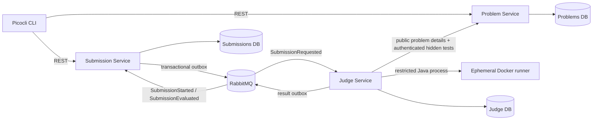

# MiniJudge Architecture

Each service owns its database. Services communicate through REST contracts or
versioned RabbitMQ events; none reads another service's tables. The Judge
Service's Docker adapter is behind the `CodeExecutor` interface so the
orchestration/evaluation code does not depend on a particular sandbox vendor.

The Problem Service's public problem response contains sample cases only. The
complete test suite is available only through the internal API when the
configured `X-Internal-Token` matches.
